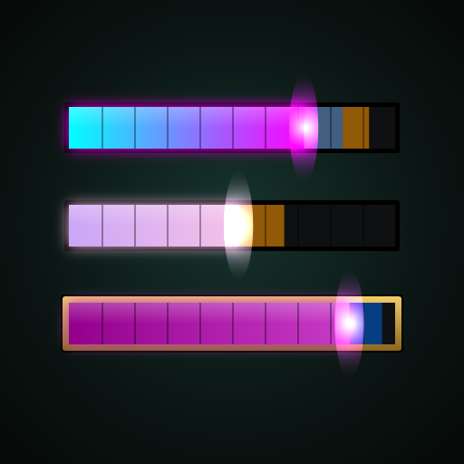
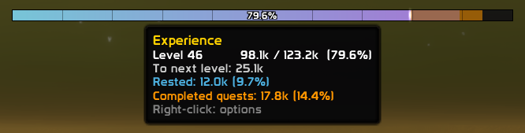
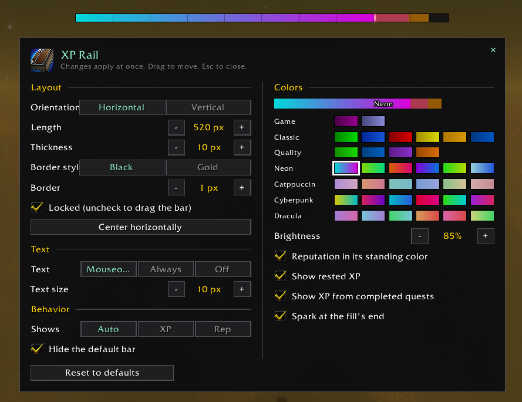

# XP Rail

**A clean experience and reputation bar in place of the game's own**, made for WoW: Forever.
It fits the default UI and mUI alike.

- **Experience below max level, then your watched reputation.** Or set it to show
  only one of them.
- **Rested XP** as a faint blue fill ahead of your XP.
- **XP from completed quests** as an orange fill: how far you get by turning in
  what's finished. Read from your quest log without changing which quest is selected.
- **Any size, either way:** set the length and thickness in pixels, horizontal or
  vertical.
- **Movable:** uncheck "Locked" (or `/xprail unlock`) and drag it anywhere.
- **Colors:** the game's own XP purple, your class color, Classic bar colors (Health,
  Mana, Rage, Energy, Cast bar, Rested), item quality colors, and the Neon,
  Catppuccin, Cyberpunk and Dracula sets from Cooldown Skin. Reputation can keep
  its standing color (red for Hostile, green for Friendly and so on).
- **Border:** black like mUI, or gold like the default unit frames.
- **Tooltip** with the exact numbers, XP to the next level, rested and quest XP,
  this session's XP per hour and the time to level up.
- English and German.

## Install

Copy this repository's files into a folder named `XPRail` inside
`World of Warcraft\_forever_\Interface\AddOns\`.

## Options

Type `/xprail`, right-click the bar, click XP Rail in the minimap addon menu, or go
to Options > AddOns > XP Rail. Every change applies at once.

| Command | What it does |
| --- | --- |
| `/xprail` or `/xpr` | Open the options window |
| `/xprail unlock` | Unlock the bar so you can drag it |
| `/xprail lock` | Lock it again |
| `/xprail reset` | Back to the defaults |

Turning "Hide the default bar" off brings the game's bar back after a `/reload`.

## Changes

See [CHANGELOG.md](CHANGELOG.md).

## License

MIT, see [LICENSE](LICENSE).
